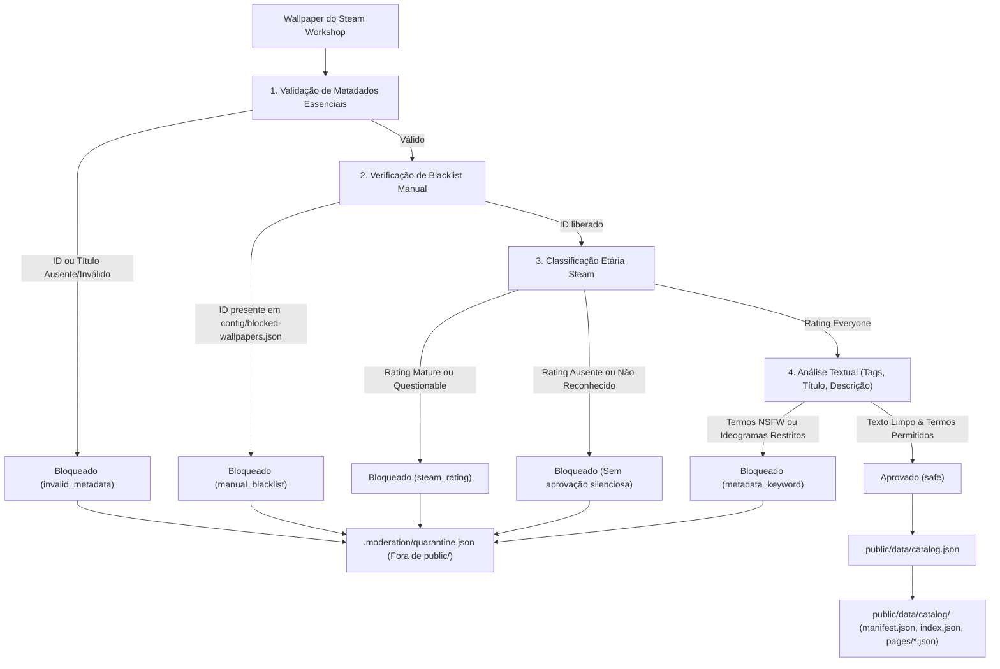

# WallpaperGallery — Relatório Técnico: Simplificação da Moderação NSFW

Data: 15 de Outubro de 2026  
Status: Implementado, Validado e Simplificado  
Cobertura de Testes: 132 testes aprovados (36 suítes)

---

## 1. Contexto e Decisão Arquitetural

O WallpaperGallery é uma galeria web para explorar wallpapers publicados no Steam Workshop do Wallpaper Engine (AppID `431960`), fundamentada na arquitetura **JSON-First**.

Após a implementação inicial de um pipeline com visão computacional e heurística cromática YCbCr, avaliou-se a relação entre complexidade operacional, previsibilidade e custo de manutenção. A Steam já fornece classificação etária oficial (`Mature`, `Questionable`, `Everyone`) e mecanismos de denúncia.

Decidiu-se **simplificar a moderação de conteúdo**, mantendo uma proteção robusta, previsível, 100% gratuita e de fácil manutenção por um único desenvolvedor, sem dependência de visão computacional, downloads adicionais de imagens ou inteligência artificial local.

---

## 2. Arquitetura Simplificada

O pipeline de moderação opera em duas fases determinísticas durante os processos de sincronização e reconstrução offline (Node.js):



---

## 3. Componentes Removidos

Foram integralmente expurgados do repositório os módulos e utilitários que existiam exclusivamente para a moderação visual:

| Componente Removido | Motivo da Remoção |
| :--- | :--- |
| **Heurística Cromática YCbCr** | Complexidade desnecessária; risco de falsos positivos em paisagens com tons de terra/areia. |
| **Cálculo de Proporção de Pele** | Inconsistente para ilustrações abstratas e estilos variados de arte digital. |
| **Download de Thumbnails no Backend** | Custo de rede, latência e dependência da CDN da Steam durante o build. |
| **Validação de Magic Bytes de Imagens** | Usada unicamente para as imagens baixadas pelo classificador visual. |
| **Cache SHA-256 de Imagens** | Arquivo `.moderation/visual_cache.json` e lógica de hashing eliminados. |
| **Thresholds Arbitrários de Incerteza** | Eliminação do estado intermediário `review`; o pipeline agora é estritamente binário (`safe` ou `blocked`). |
| **Arquivo `visualModerator.ts`** | Excluído fisicamente do projeto, reduzindo o volume de código em mais de 430 linhas. |

---

## 4. Componentes Preservados

| Componente | Função e Salvaguardas |
| :--- | :--- |
| **Classificação Etária da Steam** | Bloqueio imediato de wallpapers marcados oficialmente como `Mature` ou `Questionable`. |
| **Moderação Textual Normalizada** | Varredura de Título, Descrição e Tags via normalização Unicode NFKD (remoção de acentos) e limites de palavra (`\b`). |
| **Filtro de Ideogramas Orientais** | Bloqueio de gírias e marcadores adultos frequentes na comunidade asiática (ex: `18禁`, `成人`, `无修`, `露点`, `工口`, `エロ`). |
| **Salvaguarda de Termos Ambíguos** | Lista branca garantindo que palavras genéricas (`anime`, `girl`, `romance`, `art`, `cosplay`, `waifu`, `cute`, `model`) não causem falsos bloqueios. |
| **Tolerância a Placeholders** | Reconhecimento de formatações legítimas de arquivo (ex: `夜莺Night——XXX`). |
| **Quarentena e Rastreabilidade** | Registro detalhado de cada rejeição em `.moderation/quarantine.json` (fora de `public/`). |
| **Gravação Atômica e Particionamento** | Locks de concorrência e geração consistente de shards com limpeza de arquivos obsoletos. |

---

## 5. Blacklist Manual (`config/blocked-wallpapers.json`)

Para fornecer controle editorial imediato e rastreável sem necessidade de alterar código, foi introduzido o arquivo `config/blocked-wallpapers.json`.

### Estrutura do Arquivo:
```json
{
  "blockedIds": [
    "1234567890",
    "9876543210"
  ]
}
```

### Regras e Validações:
- **Comparação como String**: Todos os IDs são comparados estritamente como strings, preservando zeros à esquerda e compatibilidade com valores inteiros de 64 bits da Steam.
- **Detecção de Duplicatas**: A função `validateManualBlacklist` valida o JSON e lança erro explícito caso encontre duplicatas (ex: `Blacklist manual contém IDs duplicados: 100`).
- **Prioridade Absoluta**: Se um ID constar na blacklist, o wallpaper é bloqueado imediatamente com motivo `manual_blacklist`, independentemente de sua classificação ou metadados na Steam.

### Como Adicionar ou Remover um Wallpaper da Blacklist:
1. **Para bloquear**: Adicione o PublishedFileID da Steam no array `"blockedIds"` do arquivo [`config/blocked-wallpapers.json`](file:///home/renato/Documents/VSCode/WallpaperGallery/config/blocked-wallpapers.json).
2. **Para desbloquear**: Remova o PublishedFileID correspondente do array `"blockedIds"`.
3. **Para aplicar**: Execute o comando de reconstrução offline:
   ```bash
   npm run moderate:rebuild
   ```

---

## 6. Comportamento para Dados Incompletos ou Inválidos

Em conformidade com o princípio de segurança preventiva, **não existe aprovação silenciosa de dados inválidos ou desconhecidos**:

1. **Classificação etária ausente (`rating` vazio, nulo ou indefinido)**:
   - O item é **bloqueado** com o motivo: `"Classificação etária da Steam ausente; aprovação silenciosa não permitida."`
2. **Classificação etária desconhecida (ex: `'Unrated'`, `'Unknown'`, etc.)**:
   - O item é **bloqueado** com o motivo: `"Classificação etária da Steam desconhecida ou inválida; aprovação silenciosa não permitida."`
3. **ID ou Título ausente ou vazio**:
   - O item é **bloqueado** com categoria `invalid_metadata`.

---

## 7. Resultados da Reconstrução Offline

Ao executar a reconstrução do catálogo com o pipeline simplificado:

```bash
npm run moderate:rebuild
```

O comando opera de forma direta, rápida (<100ms) e sem necessidade de flags como `--skip-visual`:

| Categoria | Quantidade | Percentual | Observação |
| :--- | :---: | :---: | :--- |
| **Total Analisado no Catálogo** | **178** | 100% | Catálogo público sanitizado |
| **Aprovados (`safe`)** | **178** | **100%** | Todos em total conformidade |
| **Bloqueados por Blacklist** | 0 | 0% | Nenhum ID inserido na blacklist padrão |
| **Bloqueados por Steam Rating** | 0 | 0% | Os 21 itens Mature/Questionable já foram purgados |
| **Bloqueados por Metadados** | 0 | 0% | O item com termo adulto em descrição já foi purgado |

- **Backup criado**: Preservado em `.moderation/backups/`.
- **Shards**: Mantidos exatamente em 8 páginas (`000001.json` a `000008.json`), com `manifest.json` e `index.json` sincronizados.

---

## 8. Evidências de Testes

A suíte [`tests/moderation.test.mjs`](file:///home/renato/Documents/VSCode/WallpaperGallery/tests/moderation.test.mjs) foi reestruturada para cobrir todos os 10 cenários requeridos:

1. Bloqueio por `Mature` e `Questionable`.
2. Bloqueio por palavras-chave (título, descrição, tags e ideogramas).
3. Bloqueio por blacklist manual.
4. Aprovação de wallpapers comuns.
5. Prevenção de falsos positivos textuais.
6. IDs duplicados e formato inválido na blacklist.
7. Classificação etária ausente ou desconhecida.
8. Reconstrução offline de catálogo existente (`rebuildCatalog`).
9. Remoção de itens bloqueados de manifesto, índice e shards.
10. Preservação dos wallpapers permitidos.

### Resultados dos Comandos de Validação:
- `npm test`: **132 testes aprovados em 36 suítes** (0 falhas).
- `npm run typecheck`: **0 erros** (`tsc -b && tsc -p tsconfig.scripts.json`).
- `npm run build`: **Vite build concluído com sucesso em 3.15s**.

---

## 9. Limitações Conhecidas

- **Evasão Textual**: Autores que usarem leetspeak incomum ou omitirem tags adultas marcando fraudulentamente como `Everyone` dependerão da moderação comunitária da Steam ou da inclusão manual do ID em `config/blocked-wallpapers.json`.
- **Thumbnails Inócuas em Vídeos/Aplicações**: Como a moderação visual foi removida, thumbnails não reveladoras de conteúdos dinâmicos não são inspecionadas localmente. A blacklist manual supre eventuais casos identificados pela comunidade.
